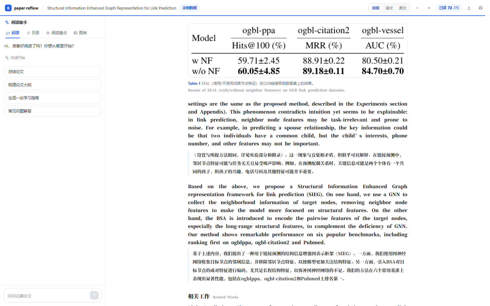

# paper-reflow

学术论文 PDF 的**版面重排 + 英中逐段翻译**。

把双栏排版的论文 PDF 拆成按阅读顺序排列的结构化块（标题 / 段落 / 公式 / 图 / 表 / 参考文献），
再逐段调用大模型翻译成中文。输出是干净的 JSON，方便接入阅读器、导出 Markdown，或做双语对照。

## 桌面版（Windows）

Windows 10/11 x64 安装包发布在 GitHub Releases，构建、签名与自动更新说明见
[docs/desktop.md](docs/desktop.md)。桌面版自带 Python sidecar，使用者不需要安装
Python/Node；数据默认在 `%LOCALAPPDATA%\paper-reflow-data`。

## 能解决什么

- **双栏阅读顺序**：检测栏间空白，跨栏元素（通栏图、标题）作为锚点，按「左栏→右栏」重排。
- **段落重组**：以「行」为最小单位而不是 PDF 的 block——学术 PDF 常把标题和正文塞进同一个 block。
- **行内公式不切断段落**：按文字基线把公式碎片并回正文行。
- **图表保留**：图片、表格、显示公式裁成 PNG；表格额外用 PyMuPDF 识别出 HTML 结构。
- **翻译质量**：两阶段（术语表 → 逐段带上下文），公式/引用编号/基因名用占位符保护，引用编号不会被改。

## 安装

```bash
pip install -e .
# 或只用不装
pip install pymupdf openai
```

## 文献库（首页）


打开就是文献库，左边导航，右边是论文卡片网格：

- **上传即读**：点「添加文章」或把 PDF 拖进窗口，支持多选；上传后立刻后台解析，并自动跳进阅读页
  （解析没完成时阅读页会显示「正在解析」并自动重试）
- **按页懒翻译 + 逐段流式**：阅读页打开时只请求**当前页 + 下一页**，服务端每翻完一段就推一条 SSE，
  首段约 **2–3 秒**出现，其余段落陆续补上
- **自愈**：单飞（同一时刻只跑一条流）+ 3 秒看门狗，流被中断 / 429 / 网络抖动都会自动重试，
  不会停在"一直转圈但不动"
- **优先翻译停留页**：滚动停稳 700ms 才开始翻译；如果正在翻的页已经被划走，直接中止，
  把配额让给真正停留的那一页
- **未配置时始终可见**：顶栏常驻「未配置模型」橙色提示，点击直达设置——不会出现"什么都没发生"
- **状态**：`解析中 → 已就绪`，失败可重试
- **检索与整理**：搜索（标题 / 作者 / 文件名）、筛选（全部 / 已就绪 / 未翻译 / 解析失败）、排序（最近 / 标题 / 页数）、网格与列表切换
- **从 Zotero 导入**：读本机 Zotero 7 的本地 API，只导入带 PDF 附件的条目。
  需要在 Zotero「设置 → 高级」里允许其他应用访问，否则会提示连不上（不影响拖拽上传）
- 点卡片进入阅读页，左上角返回

数据落在 `data/`：`papers/{id}.pdf`、`{id}.thumb.png`（首页缩略图）、`{id}.blocks.json`，索引在 `library.json`。

## 快速开始

**完整应用（推荐）**

```bash
pip install -e ".[server]"
cd web && npm install && npm run build && cd ..
python -m server.main      # http://127.0.0.1:8010
```

**开发模式**

```bash
python -m server.main                   # 终端 1：API（8010）
cd web && npm run dev                   # 终端 2：前端（5173，/api 已代理）
```

## 命令行

```bash
export PAPER_REFLOW_API_KEY=sk-xxx          # 或 OPENAI_API_KEY
export PAPER_REFLOW_MODEL=deepseek-chat

# 只解析
paper-reflow paper.pdf -o out

# 解析 + 全文翻译
paper-reflow paper.pdf -o out --translate

# 先翻 20 段看看效果
paper-reflow paper.pdf -o out --translate --limit 20
```

## 公式识别（图片 → LaTeX）

显示公式默认是**裁图**。开启识别后会额外产出 LaTeX，前端用 KaTeX 矢量渲染，可复制、可缩放。

```bash
# 解析 + 识别公式（需要视觉模型）
paper-reflow paper.pdf -o out --formula
```

识别在**解析阶段**完成并写入 `blocks[].latex`，阅读时不再调模型；结果按图片 sha1 缓存在
`~/.cache/paper-reflow/formula/`，同一公式重跑零成本。识别失败或 KaTeX 不支持时，前端自动回落到裁图。

### 设置模型与密钥


右上角齿轮打开设置，填服务商 / 接口地址 / 模型名 / API Key。配置存在**本机 localStorage**。
浏览器直连国内厂商接口会被 CORS 拦，所以需要一层本地服务：

```bash
pip install -e ".[server]"
python -m server.main            # 默认 8010
# 离线联调（不消耗额度）： PAPER_REFLOW_MOCK=1 python -m server.main
```

开发时 `npm run dev` 会把 `/api` 代理到 `127.0.0.1:8010`；生产构建后
`python -m server.main` 同时托管 `web/dist`，打开 http://127.0.0.1:8010 即可。

## 从「读完」到「搞懂」

阅读器只解决"读完一篇论文"。完整的产品设计（导读、脉络、追本溯源、三路问答、自测）
见 **[docs/design-tutor.md](docs/design-tutor.md)**。

当前已实现 P0–P2 + 问答：

```bash
POST /api/papers/{id}/guide                     → 生成导读（概念 → 前置文献 → 阅读路径）
GET  /api/papers/{id}/guide                     → 读取缓存的导读
GET  /api/papers/{id}/block/{bid}/provenance    → 这段引用了谁、原文怎么说
POST /api/papers/{id}/lineage                   → 生成思路来源图（谁启发了本文、改了什么）
GET  /api/papers/{id}/lineage                   → 读取缓存
POST /api/papers/{id}/ask                       → 三路问答（本文 / 引用文献 / 网页），带出处
```

**问答不是纯 Agent**：默认走确定性管道（BM25 检索论文段落 → 生成带页码引用的回答，约 6s）；
只有问题涉及"最新进展/其他方法/领域对比"或论文内检索分数过低时，才升级为网络检索（Tavily）。
网络结果在回答里用 `[W1]` 标注，和 `[P3]`（第 3 页）、`[R31]`（参考文献 31）区分开。

**脉络**只保留"作者在正文里描述过关系"的文献，每条边绑定一句原文证据；判不出关系的直接丢弃。
同一类"借了什么"会去重，避免 5 篇特征选择方法都显示成同一句背景。

**导读**的"前置知识"**只从本文自己的参考文献里选**（不查外部库）。实测用概念去全球检索，
命中率很低——搜 `regulation type` 会返回《Hallmarks of Cancer》这种无关高被引论文。

**溯源**：正文里的 `[31]` / `(Zhang et al. 2018)` 会被解析到参考文献条目，
再按 DOI / arXiv / 标题去取摘要，挑出与这句话最相关的一句原文，不改写。
解析不到就只显示文献条目和链接，不硬凑。

阅读页里段落 hover 会出现「引」按钮；也可以用 `?p={id}&prov={blockId}` 直接打开某段的出处。

## 前端（论文阅读页）


是一个独立的单页应用（React + Vite，无 UI 框架依赖），只做「论文这一页」：

- **左侧阅读助手**，五个标签切换：
  - **导读**（默认）—— 3 分钟读懂这篇：一句话总结、领域、难度、**前置知识清单**（附"为什么"和对应文献）、**推荐阅读顺序**
  - **问答** —— 快速问题（总结 / 大纲 / 学习指南）+ 输入框
  - **目录** —— 一二级标题，随滚动高亮
  - **阅读重点** —— 每个章节取首句，用于扫读
  - **图表** —— 全部插图与表格的缩略图，点击跳转
- **正文**：英文原文在上、中文译文在下（术语用蓝色虚线下划线标注，悬停显示英文原词）；
  三档模式切换（对照 / 译文 / 原文）、字号调节、段落复制、页内深链（`#b0013`）
- **表格只做整图切片**，不解析表结构——合并单元格、跨行跨列交给原始排版，避免提取出错误的数据
- 导出 Markdown、打印/存 PDF



```bash
cd web
npm install
npm run dev        # http://localhost:5173
npm run build      # 产物在 web/dist
```

默认读 `web/public/demo/paper.json`——这是用真实论文跑出来的示例数据（160 块 / 71 段真实机翻），
**不需要后端就能看效果**。其中 3 个公式带人工核对的 LaTeX（用于对比 KaTeX 与裁图两种渲染），其余仍是裁图。接后端时设置环境变量即可切换：

```bash
VITE_API_BASE_URL=http://localhost:8000/api npm run dev
```

约定的接口：

```
GET  {API}/papers                    → { papers: [...] }
POST {API}/papers/upload             → multipart，上传后自动解析
GET  {API}/papers/{id}/blocks        → { title, page_count, blocks: [...] }
POST {API}/papers/{id}/translate     → { config, pages?: [1,2] }  按页翻译，不传 pages 则整篇
POST {API}/papers/{id}/translate/stream → SSE，逐段推送（阅读页用这个）
GET  {API}/papers/{id}/thumb         → 首页缩略图
```

SSE 事件：

```
{"type":"start","pages":[7,8],"total":25}
{"type":"block","block":{...}}    × N，每段翻完立刻推
{"type":"done","translated":25}
{"type":"error","message":"..."}
```

Python API：

```python
import asyncio
from paper_reflow import build_glossary, parse_pdf, translate_paper

async def main():
    paper = parse_pdf("paper.pdf", figure_dir="out/assets")

    print(paper.page_count, paper.columns, len(paper.blocks))
    for b in paper.blocks[:5]:
        print(b.kind, b.text[:60])

    glossary = await build_glossary(paper.blocks)     # 术语表（可跳过）
    await translate_paper(paper.blocks, glossary)     # 逐段翻译，原地写回

asyncio.run(main())
```

## 输出

`out/paper.blocks.json`：

```json
{
  "source": "paper.pdf",
  "page_count": 9,
  "columns": 2,
  "blocks": [
    {
      "id": "b0006", "order": 6, "page": 1, "kind": "para", "level": 0,
      "section": "Abstract",
      "text": "Link prediction is a fundamental task ...",
      "translated": "链接预测是图机器学习的一项基础任务……",
      "bbox": [64.0, 236.0, 282.5, 484.0],
      "image_path": null, "table_html": "", "caption": "",
      "translatable": true
    }
  ]
}
```

`bbox` 是 PDF 页面坐标（左上原点、单位 pt），可以直接用来在原文上画高亮框。

`kind` 取值：`title` / `author` / `affiliation` / `keywords` / `heading` / `para` /
`equation` / `caption` / `figure` / `table` / `reference` / `footnote`。

## 配置

| 环境变量 | 说明 | 默认 |
|---|---|---|
| `PAPER_REFLOW_API_KEY` / `OPENAI_API_KEY` | API Key | 必填 |
| `PAPER_REFLOW_BASE_URL` / `OPENAI_BASE_URL` | OpenAI 兼容地址 | `https://api.deepseek.com/v1` |
| `PAPER_REFLOW_MODEL` / `OPENAI_MODEL` | 模型名 | `deepseek-chat` |
| `PAPER_REFLOW_TIMEOUT` | 单请求超时（秒） | `300` |

任意 OpenAI 兼容服务都能接（SiliconFlow / vLLM / Ollama / OneAPI）。宿主应用也可以注入自己的实现：

```python
from paper_reflow import set_backend

class MyBackend:
    async def chat(self, messages, *, model=None, temperature=0.25, max_tokens=None) -> str:
        return await my_internal_llm(messages)

set_backend(MyBackend())
```

## 设计要点

**为什么以「行」为单位。** PDF 的 block 太粗：`Introduction` 标题和正文经常在同一个 block 里，
按 block 处理会把标题吞进正文。按行拆分后才能准确识别标题层级。

**为什么用文字基线判断同一行。** 行内公式是独立的 glyph run，PyMuPDF 会识别成「同一基线上的另一行」。
用 bbox 中心判断会被高公式（分式、求和号）误导，把下一行正文吞进公式；用 span 的 `origin.y` 才稳。

**为什么翻译要两阶段。** 逐段独立翻译会出现同一术语前后不一致（GWAS 一会儿「全基因组关联分析」
一会儿「基因组关联研究」）。先扫一遍标题+摘要产出术语表，再逐段带上术语表、章节标题、
上一段译文结尾、下一段原文开头。

**为什么用 `⟦P0⟧` 而不是 `⟦0⟧`。** 模型有时会自己写出 `[2]` 这样的方括号数字；如果还原时把任何
`[数字]` 都当占位符，引用编号就会整体错位。加个 `P` 前缀后模型几乎不可能自发产出这种形态。

## 已知限制

- **公式以整图切片呈现**：分段函数、分式、根号都能完整裁出，但本质是位图，放大后不如矢量清晰，
  也不能复制 LaTeX；公式编号 `(3)(4)` 可能落在裁切框外。
- **行内公式无法还原**：正文里的 `x = y` 这类公式只有字形、没有语义，会以原始字形出现在段落中
  （如 `qi = hiW Q`）。要彻底解决需要「公式识别 → LaTeX」这一层，本项目没做。
- 多行大括号方程组偶尔会被拆成几个块（已用「纵向重叠 + 停用词」规则尽量合并）。
- 表格用 PyMuPDF 的 `find_tables()`，合并单元格可能拼进同一格；此时可用同目录下的裁图兜底。
- 矢量图的区域识别偏保守，个别图可能被并入相邻区域。
- 目前只做**英译中**；术语表提示词与译文质检阈值都按中英字符比设计。
- 扫描件（无文本层）暂不支持，需要先接 OCR。

## 测试

```bash
pip install -e ".[dev]"
pytest
```

测试不依赖真实 PDF，覆盖 span 拼接、公式误判、`et al.` 缩写、跨行误合并、占位符错位等回归点。

## 目录

```
paper_reflow/
  layout.py     PDF → 结构化块（栏检测 / 阅读顺序 / 段落重组 / 图表公式裁剪）
  formula.py    公式裁图 → LaTeX（视觉模型 + 校验 + 缓存）
  translate.py  术语表 + 占位符 + 逐段翻译
  llm.py        LLM 接入（默认 OpenAI 兼容，可注入）
  cli.py        命令行入口
server/          本地服务
  main.py        API：文献库 / 公式识别 / Zotero / 静态托管
  store.py       论文文件与元信息、首页缩略图
web/             前端（React + Vite + KaTeX）
  src/components/  LibraryPage · PaperCard · Sidebar（文献库）
                   ReaderView · TopBar · LeftPanel · Reader · BlockView（阅读页）
                   SettingsDialog · Katex
  src/lib/         api · library · settings · blocks · highlight · assistant · markdown
  public/demo/     真实论文的示例数据
tests/
examples/
docs/           预览截图
```

## License

AGPL-3.0。桌面版安装包与对应源码见 GitHub Releases；第三方组件许可见
[THIRD_PARTY_NOTICES.md](THIRD_PARTY_NOTICES.md)。
