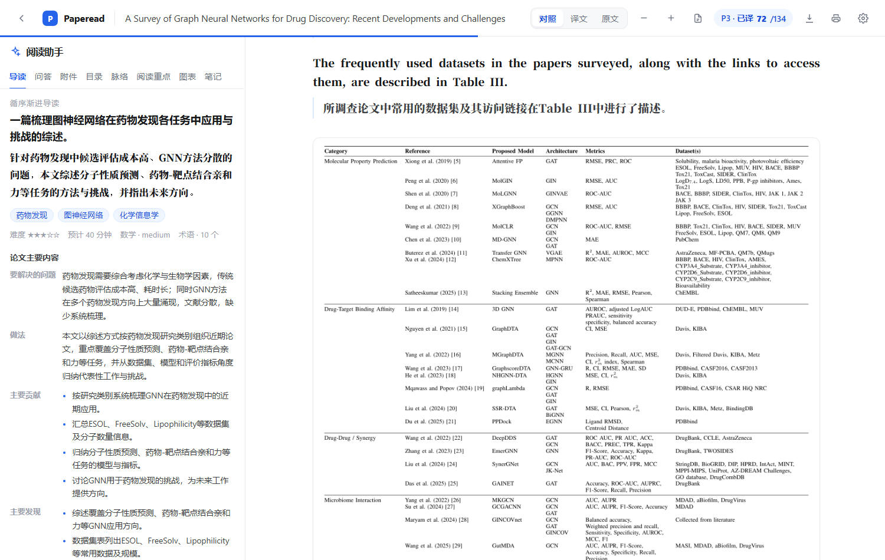

# Paperead

**把英文论文从「读完」变成「读懂、能查、能写」。**

Paperead 是一个本地论文工作台：重排双栏 PDF、按页流式翻译成中文，再把导读、问答、引用溯源和思路脉络放进同一个阅读页。需要找论文、做研究或写综述时，可以新建项目，让 agent 在文献库、学术检索和项目文件之间连续工作。

> **Windows 桌面版**：[GitHub Releases](https://github.com/xiaohui-plus/Paperead/releases/latest)
> · [Gitee 安装包](https://gitee.com/deng_xiaohui/paperead/releases/download/v0.1.6/Paperead_0.1.6_x64-setup.exe)
> · [便携版](https://github.com/xiaohui-plus/Paperead/releases/download/v0.1.6/Paperead_0.1.6_portable_x64.zip)
> · 源码启动见下文「安装与启动」。

## 核心能力

| 能力 | 你能得到什么 |
|---|---|
| **重排阅读** | 双栏按阅读顺序重排，跨栏图表、公式、表格保留；表格单独成块，页内可深链跳转 |
| **双语翻译** | 按页流式翻译，首段通常 2–3 秒出现；术语前后一致，可切对照 / 译文 / 原文 |
| **高亮笔记** | 正文划词高亮四色可选，点高亮写笔记；笔记侧栏可跳回原文、导出 Markdown |
| **阅读重点** | 每翻完一页自动标出研究目标、研究方法、主要结论，正文三色标记，侧栏中英对照摘录 |
| **读到哪里** | 自动记住阅读位置，下次打开回到原处；文献库显示进度，可按在读 / 未读 / 已读完筛选 |
| **读懂论文** | 导读告诉你先补什么、按什么顺序读；问答带页码出处；引用可追到原文 |
| **手机阅读** | 安卓壳连本机服务：阅读页顶栏两行、面板收进底部工具条，文献库和项目页自适应手机屏幕 |
| **找文献** | arXiv / PubMed / OpenAlex / Europe PMC 四源检索，开放获取 PDF 一键入库 |
| **双向同步** | 和 Zotero 双向同步论文、PDF、分类与归属，不是单向导入 |
| **做研究** | 项目制 agent：查文献、读全文、整理、起草，长结果写回项目 |
| **写综述** | 从大纲、证据、初稿到引用核验，产出留在项目里可继续改 |
| **配模型** | 回答模型与识图模型分开；预设服务商直接选，也支持任意 OpenAI 兼容接口 |

---

## 文献库

打开应用就是文献库。所有论文在本地管理，上传后自动解析，不需要先整理文件。


- **上传即读**：把 PDF 拖进窗口或点「添加文章」，上传后自动解析并进入阅读页。
- **文件夹管理**：新建单层文件夹，把论文拖进文件夹；空文件夹和已有论文的文件夹使用不同图标。拖到左边缘「全部文献」投放条停留 0.7 秒即可移出，移出后还能继续拖到另一个文件夹。
- **从 Zotero 导入**：读取本机 Zotero 7+ 的本地 API，可按分类和标题 / 作者筛选，只导入带 PDF 的条目；也可以「同步全部」把当前分类里新增的条目一次增量导入。需要在 Zotero「设置 → 高级 → 杂项」里允许其他应用通讯。
- **和 Zotero 双向同步**：点「Zotero 同步」，粘贴在 `zotero.org/settings/keys` 创建的带写权限 API Key 即可，用户 ID 会自动识别。远端有、本地没有的条目会连同 PDF 拉进来并解析；本地新增的论文、PDF 和文件夹会推到 Zotero；分类（文件夹）和论文归属两边互相合并。删除目前只在报告里计数，不会自动双向传播。
- **找得到、管得住**：搜索、筛选、排序俱全；解析失败可以重试。
- **状态可见**：`解析中 → 已就绪`，失败会给出原因。

论文和阅读记录留在本地；只有调用模型时，才会把必要的文本或图片发给你配置的服务商。从旧的 paper-reflow 升级时首次启动会自动迁移。

---

## 阅读页

阅读页只做一件事：让你在一屏里同时看到原文、译文和辅助理解的内容。


### 版面重排

- **双栏按阅读顺序重排**：通栏标题和跨栏图表作为锚点，不再左右栏混读。
- **标题和段落分得清**：章节标题不会被吞进正文；行内公式会并回原句，一句话仍是一段。
- **图表和公式保留**：插图、表格、显示公式裁成图片，不会被打散成一行行文字。
- **表格单独成块**：表格从正文流里抽出来单独成块，按高清裁图展示，不再混进段落文字；导出 Markdown 时会尽量还原成表格结构。



### 翻译

- **只翻你正在看的页**：打开阅读页先翻当前页和下一页，滚动停稳后再继续，不一次性翻完整篇。
- **逐段出现**：每翻完一段就推一段，不用等整页翻完。
- **中断会自愈**：流断了、限流、网络抖动都会自动重试；当前页被划走时，会把配额让给真正停留的页。
- **术语和符号稳定**：同一术语前后一致；公式、引用编号、基因名在翻译中保持原样。
- **三种读法**：对照（英文在上、译文在下）/ 译文 / 原文。
- **译文语言可切换**：设置 → 译文语言可选简中、繁中、日、韩、法、德、西、俄；切换后旧译文会按新语言重翻，原文、高亮和笔记不受影响。

### 高亮与笔记

- **划词即标**：在原文或译文里选中文字，浮条上选颜色即可高亮，四种颜色区分用途。
- **点高亮写笔记**：点已有高亮可改颜色、补笔记或删除；笔记只存在本机。
- **笔记侧栏**：左侧「笔记」集中列出全文标注，按页排序，点「跳到原文」直接定位，也能一键导出 Markdown。
- **自动续读**：滚动停稳后记住位置，下次打开这篇论文自动回到原处；文献库卡片显示读至百分之多少。

### 引用

- **点编号看引文**：正文里的 `[12]`、`(Smith et al., 2020)` 可直接点击，弹出这一条（或这一组）的标题、年份、原文片段和链接。
- **浮窗跟着正文走**：滚动时浮窗跟着正文一起移动，始终落在可视区域内；同一时间只保留一个浮窗，滑远后自动关闭，不会越点越多。
- **整段溯源**：段落右侧「引」会列出这段话引用的全部文献，片段取自原文摘要，不改写。

### 阅读重点

- **边读边标**：当前页翻译完成后，自动识别研究目标、研究方法、主要结论，用蓝、绿、橙三种颜色标在原文和译文上。
- **只标有的**：论文没写的内容不硬凑；模型必须逐字引用原文和译文，改写过的句子会被丢弃。
- **中英对照摘录**：左侧「阅读重点」按三类分组，逐条给出英文原句、译文和页码，点击回到原文。
- **旧论文兜底**：已经翻译过但还没提取重点的论文，打开后会自动补提取，不会重复计费。
- **可以关掉**：设置 → 自动阅读里可以关闭「自动标记阅读重点」，关闭后不再产生额外模型调用，已有标记和手动笔记保留。

### 原版 PDF

顶栏一键切到原版排版：连续滚动、可缩放，不依赖浏览器 PDF 插件。切换时保留当前页和阅读位置，左侧导读、问答、目录、图表照常可用。

### 公式识别

公式默认以裁图呈现。开启识别后，解析阶段会额外产出 LaTeX，阅读页用 KaTeX 矢量渲染，可复制、可缩放；识别失败时自动回落到裁图。

### 阅读助手


| 面板 | 能做什么 |
|---|---|
| **导读** | 3 分钟总结、领域与难度、前置知识清单（每个概念说明为什么需要、对应哪篇文献）、推荐阅读顺序；可以标记「已掌握」 |
| **问答** | 快速总结 / 大纲 / 学习指南 / 常见问题，也可以自由提问；回答流式输出，带页码、文献、网页出处，点页码跳原文 |
| **溯源** | 点「引」把 `[31]` / 作者年份解析到参考文献，取原文摘要里最相关的一句，不改写；取不到就说明原因 |
| **脉络** | 时间轴：谁启发了本文、本文借了什么、又改了什么；每条关系绑定原文证据，判不出关系的直接丢弃 |
| **目录 / 阅读重点 / 图表** | 目录随滚动高亮；重点按章节取首句；图表缩略图一键跳到正文 |
| **附件** | 每篇论文的补充材料单独归档，上传后可随时预览，不混进项目文件 |

问答默认先在论文内部检索，涉及最新进展、其他方法或领域对比时才联网；可以随时关掉联网，也可以随时切换回答模型。

### 问答记忆

每篇论文一条长会话：刷新、切标签不丢，追问能接上；会记住聊过什么、你的判断和答法偏好，逐渐调整讲法。记忆只存在本地，可备份、可整体删除；设 `PAPEREAD_MEMORY=0` 可关闭。

阅读页还支持导出 Markdown、打印或存为 PDF。

### 手机端阅读

安卓壳连接本机服务后，阅读页会按手机屏幕重新排布：

- **顶栏折成两行**：论文标题一行，模式和工具一行，不会再横向溢出。
- **面板收进底部工具条**：导读、问答、附件、目录、脉络、阅读重点、图表、笔记 8 个面板常驻屏幕底部，点开从下方弹出抽屉，点条目跳到正文后自动收起。
- **引用浮窗同样可用**：跟随滚动、只开一个、滑远自动关闭，触屏下也不会叠成一堆。
- **离线可读**：文献库里可以把论文下载到手机，没网时继续看已下载的内容。

---

## 文献检索


- **四个源**：arXiv（预印本）、PubMed（生物医学）、OpenAlex（全学科 + 被引量）、Europe PMC（生物医学全文）。
- **查得准**：字段、分类、年份、短语等高级检索；中文查询会先译成英文，界面回显实际检索词。
- **每日推荐**：没有关键词时按热度、时间和分类均衡推荐 12 篇；同一天结果稳定，「换一批」不重复。
- **一键入库**：开放获取 PDF 直接导入文献库并解析，重复导入会打开原条目。
- **引用导出**：GB/T 7714、APA、MLA、IEEE、BibTeX、RIS 一键复制，结果页可导出 BibTeX / RIS。

---

## 研究与写综述

研究和写综述都是**项目制**：一个题目一个项目，材料、会话和产出都留在项目里，下次接着做。

### 研究


- 输入研究问题即可开始；首页有六个入口：找文献、整理文献、定研究问题、设计研究、写作修改、做汇报。
- agent 会自己查本地文献库、按页精读全文、检索四个学术源、把开放获取论文导入文献库。
- 整理结果、研究方案、写作草稿、汇报提纲会写回项目，不只在聊天里给一段字。
- 项目文件支持上传、**打开本机文件夹并保留子目录导入**，以及重命名、复制、剪切、粘贴、删除和多选（`F2` 重命名、`Delete` 删除、`Ctrl+C / X / V` 复制剪切粘贴）；手机上文件和会话收进抽屉，把高度留给对话。项目菜单里的「删除项目」会在确认后永久删除该项目下的所有文件、会话和产物。
- 过程可见：思考过程、研究计划、每次工具调用和正文都能看到；可以随时停止，刷新或重启后能接着聊。
- 要求引用可追溯：本地结论标论文和页码，外部结论标 DOI 或检索 id；没有证据就标【待补证据】，不编造文献和数据。

### 写综述


按「列大纲 → 找证据 → 写初稿 → 核引用 → 导出 / 汇报」推进。要求每个论断都能追到具体文献和页码；查不到证据的地方明确标出，而不是补一段看起来合理的话。大纲、证据清单、分节草稿和汇报提纲都留在项目里，最后可以导出 DOCX 或 BibTeX。

> 生成的是有证据、引用可核验的综述草稿，不是自动投稿的成稿；DOCX / LaTeX 导出用 pandoc（安装版首次启动自动下载、便携版自带）；编译 PDF 仍需本机有 TeX 引擎。

### 运行条件

研究 agent 是独立的本地进程，使用自己的模型配置（`PAPEREAD_LLM_KEY` / `PAPEREAD_MODEL`），和阅读页「模型与密钥」里的浏览器配置分开。源码运行时按 [agent/README.md](agent/README.md) 启动；agent 未启动时研究页会提示离线，历史会话仍可查看。agent 只能访问文献库、学术检索、网页检索和当前项目，不暴露 shell 或任意文件系统。

---

## 模型与密钥


- **两套模型**：回答模型负责问答、翻译、导读、脉络；识图模型负责公式裁图 → LaTeX。两者独立配置，互不影响。
- **预设服务商**：DeepSeek、智谱、Kimi、豆包、通义千问、硅基流动；选中后直接挑模型，接口地址和模型名自动填好。
- **自定义模型**：任何 OpenAI 兼容服务都能接，只填接口地址、模型名、API Key。
- **可测试**：保存前点「测试」验证地址、密钥和模型名；识图模型会尽量用示例公式图验证识图能力。
- **只存本机**：密钥保存在本机，随请求发给本地服务，服务端不落盘；聊天中可随时切换回答模型。

---

## 安装与启动

### Windows 桌面版

- Windows 10/11 x64，安装版 per-user 安装，不弹 UAC；数据在 `%LOCALAPPDATA%\paperead-data`，升级 / 卸载不影响文献库。
- 便携版解压后双击 `启动.cmd`，数据在同级 `data\`。
- 自带 Python 服务，使用者不需要单独安装 Python。
- 安装版首次启动会在后台下载 pandoc（约 24MB，只需一次），用于 DOCX / LaTeX 导出；便携版已自带，完全离线。
- 安装版启动后静默检查更新，之后每 6 小时一次；也可以手动「帮助 → 检查更新」。
- 构建、签名与自动更新说明见 [docs/desktop.md](docs/desktop.md)。

### 从源码启动

```bash
pip install -e ".[server]"
cd web && npm install && npm run build && cd ..
python -m server.main      # http://127.0.0.1:8010
```

也可以双击 `start.bat`（Windows）或用 `./start.sh`（macOS / Linux）。开发时前后端分开跑：

```bash
python -m server.main      # 终端 1：API（8010）
cd web && npm run dev      # 终端 2：前端（5173）
```

测试：`pip install -e ".[dev,server]"` 后运行 `pytest`。

### 命令行

```bash
pip install -e .
export PAPEREAD_API_KEY=sk-xxx
export PAPEREAD_MODEL=deepseek-flash

paperead paper.pdf -o out                       # 只解析
paperead paper.pdf -o out --translate           # 解析 + 翻译
paperead paper.pdf -o out --translate --limit 20
paperead paper.pdf -o out --formula             # 识别显示公式为 LaTeX
```

输出是结构化 JSON（块、译文、图表路径），方便接自己的阅读器。其他选项和配置见 [QUICKSTART.md](QUICKSTART.md)。

---

## 已知限制

- 公式默认是位图；行内公式只有字形、没有语义，可能以原始字形出现在段落里。开启识别后，显示公式才有可复制的 LaTeX。
- 扫描件（无文本层）暂不支持，需要先接 OCR。
- 阅读页的表格按整图展示：跨页表格、合并单元格复杂的表格不做结构还原，导出 Markdown 时按识别结果尽量还原。
- Zotero 双向同步走官方 Web API，需要在 zotero.org 创建带写权限的 API Key，且 Zotero 桌面端已登录并开启同步；删除只在报告里计数，不会自动双向传播。
- 翻译按「英文原文 → 目标语言」处理；源文不是英文时效果不保证。
- 研究 / 综述依赖本地 agent；DOCX / LaTeX 导出用 pandoc（安装版首次启动自动下载，便携版自带），编译 PDF 需要本机 TeX 引擎。
- 桌面版目前仅支持 Windows 10/11 x64。

---

## License

AGPL-3.0。桌面版安装包与对应源码见 GitHub Releases；第三方组件许可见
[THIRD_PARTY_NOTICES.md](THIRD_PARTY_NOTICES.md)。
