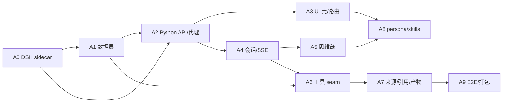

# Research Agent Phase A（非文献搜索）实施计划

> **For agentic workers:** REQUIRED SUB-SKILL: Use superpowers:subagent-driven-development (recommended) or superpowers:executing-plans to implement this plan task-by-task. Steps use checkbox (`- [ ]`) syntax for tracking.

**Goal:** 在 `Scolar_search` 接入前，把研究功能的非搜索底座做完：DSH Node sidecar、项目/会话数据、研究 UI 壳、思维链、SSE 协议、来源/产物、工具 seam 和 Fake 学术检索。

**Architecture:** Tauri 2 壳同时管理 Python sidecar 与 Node agent sidecar；React 只连 Python 同源 API，Python 代理 Node 的会话/SSE；DSH 负责 agent loop，外部学术检索藏在 `AcademicSearchBackend` 端口后面，现在用 Fake，接入后换 `ScolarSearchBackend`。

**Tech Stack:** Tauri 2 + Rust、React 19 + Vite、Python 3.12 + FastAPI + SQLite、Node 22 + DSH `0.1.0-rc.6`、Playwright + Vitest + pytest。

**关联设计：** [2026-11-08-research-agent-design.md](../specs/2026-11-08-research-agent-design.md)（§6 搜索接入边界、§10 事件协议、§16 里程碑）  
**DSH 接入完整方案：** [2026-11-08-dsh-integration-solution.md](../specs/2026-11-08-dsh-integration-solution.md)

---

## 0. 边界

### 本阶段做

- DSH sidecar 跑通：`dsh-base` + `@paperead/dsh-research`，一条 SSE、一个 echo 工具。
- 项目 / 会话 / 产物 / 来源索引的 SQLite 与 API。
- 研究首页、项目页骨架、composer、transcript、思维链组件。
- `library_search`（本地库）、`paper_read`（本地全文）、`project_write`（产物）。
- `academic_search` 的**工具契约** + `FakeAcademicSearchBackend`。
- 来源注册表、`[S1]` 引用渲染、未核实提示。
- persona、`find-literature` / `organize-library` 技能骨架。
- 假 LLM 的 E2E 与打包脚本。

### 本阶段不做

- 不重写 arXiv/PubMed/OpenAlex/Europe PMC provider。
- 不接 `Scolar_search`；不接 CNKI/万方；不接 SCI-Hub/LibGen。
- 不做综述 docx 导出、引用助手页面（M3）。
- 不改默认首页：`/` 仍是文献库，`/?p=` 仍是阅读页。

### 外部依赖

- `Scolar_search`：用户接入后提供 A. TS 包或 B. HTTP seam（设计 §6.2）。
- DeepSeek API key：研究 agent 用；没有 key 时研究入口显示“配置后开始”。

---

## 1. 依赖与顺序



**关键路径**：A0 → A1/A2 → A4 → A5 → A7 → A9。  
**可并行**：A3 可以在 A2 的 API 契约冻结后先做静态骨架；A6 的 FakeBackend 可以先于 A4 完成。

---

## 2. 工作包

### A0：DSH sidecar 打通（3–5 天）

**目标**：启动 Node agent，发一条消息，收到流式文本 + 一张工具卡；重启后能恢复会话；Tauri 壳能拉起它。

**状态：核心已跑通**（2026-11-08）

| 项 | 结果 |
|---|---|
| `node agent/src/bin.mjs` 启动（minimal） | ✅ |
| `PAPEREAD_AGENT_COMPOSE=full`（dsh-base + 研究 patch） | ✅（禁用 `hmr` 后） |
| `GET /v1/health` | ✅ `{"ok":true,...}` |
| `POST /v1/sessions` | ✅ |
| SSE `/v1/sessions/:id/events` | ✅ `retry` + 事件流 |
| 一轮：reasoning → tool draft/start/end → text → turn.end | ✅ 用假 LLM 验证 |
| 完整组合额外产生 `title.update` | ✅ |
| 重启后 `agents.resume`，turn 从 1 变 2 | ✅ |
| `AgentSidecar` Tauri 编译 | ✅ `cargo check` 通过 |
| Tauri 端到端（Python + Node + 窗口） | ✅ 用可写 `PAPEREAD_DATA` 验证，日志出现 `sidecar ready` / `agent ready` |
| Python SSE 代理（A2 最小版） | ✅ `POST/GET /api/research/*` 代理到 Node |
| `?research=spike` 页面构建 | ✅ `tsc && vite build` 通过 |
| 安装包体积 / 干净 Windows 实测 | ⏳ 待做 |

**实际实现与计划的差异**

- 没有用 `dsh --profile research`：DSH 的 profile 引导会在
  `$DSH_HOME/profiles/node_modules` 下建 junction；Node 24（Windows）把
  junction 报成普通目录，`dsh` 的 `ensureSymlink` 直接拒绝启动。
- 改为直接 `boot()`：`agent/src/bin.mjs` 加载 `minimal.yml`（快速测试）或
  `cordis.yml` + `dsh-base`/研究 patch（完整组合）。完整组合最初会卡住，
  读 DSH 源码后发现官方 web bundle 也禁用 `hmr`；在
  `bundle/cordis.patch.yml` 里 `hmr.disabled: true` 后完整组合正常启动。
- `agent/` 用 pnpm + `pnpm-workspace.yaml` 的 `overrides` 锁定全部 DSH 包到
  `0.1.0-rc.6`；npm 的 peer 解析会因为 `dsh-invariants`/`dsh-brand` 等升到 rc.8 而失败。
- Node 24 的 `node-pty`/`koffi` 构建脚本被 pnpm 忽略；当前组合没用到它们，后续若启用 shell
  工具再执行 `pnpm approve-builds`。

**文件（实际）**

- `agent/package.json`、`agent/pnpm-workspace.yaml`、`agent/pnpm-lock.yaml`
- `agent/minimal.yml`、`agent/src/bin.mjs`
- `agent/bundle/package.json`、`agent/bundle/cordis.patch.yml`
- `agent/bundle/lib/index.js`（HTTP + SSE + session/resume）
- `agent/bundle/lib/tools.js`（echo）
- `agent/test/mock-llm.mjs`、`agent/test/spike-client.mjs`
- `src-tauri/src/agent_sidecar.rs`
- `src-tauri/src/main.rs`（启动/停止、写 `agent.json` 握手）
- `web/src/research/SpikePage.tsx`、`web/src/App.tsx`（`?research=spike`）
- `server/main.py`（`GET /api/research/agent` 读握手文件）

**验收（更新）**

- `GET /v1/health` 返回 200。
- 一轮能看到 `turn.start`、`reasoning.delta`、`tool.start`、`tool.end`、`text.delta`、`turn.end`。
- 重启后同一 session 可 resume，历史不丢。
- Tauri `agent_sidecar` 能在 Python sidecar 之后启动；失败不影响文献库/阅读器。
- 安装包增量 ≤150MB；启动 ≤3s（待干净 Windows 实测）。

**测试/命令**

```powershell
cd agent
pnpm install --store-dir .pnpm-store --config.node-linker=hoisted
node test/mock-llm.mjs        # 终端 1
.\dev.ps1                     # 终端 2（指向 mock）
node test/spike-client.mjs    # 终端 3
npm run tauri -- dev          # 验证 Tauri 拉起 agent
```

**待办**

- [ ] 在干净 Windows 上实测安装包体积、启动时间、首 token 延迟。
- [ ] 处理 Windows 旧数据目录 ACL 异常：本机 `%LOCALAPPDATA%\paperead-data` 属于另一个 SID，当前用户只读；已加 `prepare` 失败回退，但还需要在真实安装包上验证。
- [ ] 给完整组合补工具/权限/技能回归测试（`hmr` 之外是否还有会拖慢启动的 watcher）。
- [ ] 把 `agent.json` 直连彻底删掉，前端只走 Python 代理（现在 SpikePage 已走代理，Tauri 仍写 `agent.json` 供代理读）。


---

### A1：研究数据层（3–4 天）

**目标**：项目、项目文件、会话索引、产物、来源、用量落 SQLite；不依赖 agent。

**文件**

- 新增 `server/research/__init__.py`
- 新增 `server/research/db.py`（连接、WAL、迁移）
- 新增 `server/research/store.py`（CRUD）
- 新增 `server/research/files.py`（上传/列表/路径校验）
- 新增 `server/research/models.py`（dataclass/TypeDict）
- 新增 `tests/test_research_store.py`
- 修改 `server/main.py`（初始化 DB）

**表**

按设计 §9.2：`projects`、`project_items`、`sessions`、`session_sources`、`artifacts`、`usage`、`search_cache`（先建空表）。

**步骤**

- [ ] `db.py`：`sqlite3.connect(path, check_same_thread=False)`，`PRAGMA journal_mode=WAL`，`PRAGMA foreign_keys=ON`；版本表 `schema_meta(version)`。
- [ ] `store.py`：`create_project` / `get_project` / `list_projects` / `update_project` / `archive_project`。
- [ ] `store.py`：`create_session` / `list_sessions` / `update_session_title` / `touch_session`。
- [ ] `store.py`：`add_project_item` / `list_project_items` / `remove_project_item`。
- [ ] `store.py`：`add_artifact` / `list_artifacts` / `get_artifact`；版本号按同 path 递增。
- [ ] `files.py`：上传到 `projects/<id>/files/`；`realpath` 必须在项目根内；拒绝 `..` 和符号链接逃逸。
- [ ] `main.py`：`PAPEREAD_DATA/research/research.db` 初始化；测试用 `tmp_path`。

**验收**

- 建项目 → 建会话 → 加文件 → 加产物 → 重启服务后仍可读。
- 路径逃逸测试失败（拒绝）。
- 并发写不出现 `database is locked`（WAL + 短事务）。

**测试/命令**

```powershell
pytest tests/test_research_store.py -q
```

---

### A2：Python 公共 API 与 Agent 代理（2–3 天）

**目标**：前端只连 Python；Python 代理 Node 的会话/SSE，并暴露项目 CRUD。

**文件**

- 新增 `server/research/api.py`（`APIRouter`）
- 新增 `server/research/agent_client.py`（HTTP + SSE 流）
- 修改 `server/main.py`（`include_router`）
- 新增 `tests/test_research_api.py`（用假 agent server）

**接口**

按设计 §11.1：`/api/research/health`、`/projects`、`/sessions`、`/messages`、`/cancel`、`/events`、`/transcript`、`/files`、`/artifacts`、`/skills`、`/trending`。

**步骤**

- [ ] `api.py`：项目 CRUD 与会话列表/创建（先不依赖 agent）。
- [ ] `agent_client.py`：`httpx.AsyncClient`；`stream_events(session_id, after)` 用 `client.stream` + `StreamingResponse`，透传 `text/event-stream`，设 `X-Accel-Buffering: no`。
- [ ] `/messages`：校验项目/会话 → 调 Node `POST /v1/sessions/:id/messages` → 202；Node 不可用返回 503 + `AGENT_UNAVAILABLE`。
- [ ] `/cancel`：转发 `POST /v1/sessions/:id/cancel`。
- [ ] `/health`：聚合 Python 与 Node 状态。
- [ ] 测试：用 `respx` mock Node，验证 SSE 原样透传、断线、503。

**验收**

- 前端只配一个 base URL 就能拿到项目、会话、SSE。
- Node 挂掉时 `/api/research/health` 返回 `agent: down`，不 500。
- SSE 不被缓冲（首事件 <500ms）。

---

### A3：研究 UI 壳与路由（2–3 天）

**目标**：不改变现有首页，新增研究入口与三张页面骨架。

**文件**

- 新增 `web/src/research/ResearchShell.tsx`
- 新增 `web/src/research/ResearchHome.tsx`
- 新增 `web/src/research/ProjectPage.tsx`
- 新增 `web/src/research/ResearchEmpty.tsx`
- 新增 `web/src/lib/researchApi.ts`
- 新增 `web/src/research/research.css`（或并入 `styles.css`）
- 修改 `web/src/App.tsx`（`view` 路由）
- 修改 `web/src/components/Sidebar.tsx`（“研究”入口）

**路由**

- `/`、`/?p=` 不变。
- `/?view=research` → 研究首页。
- `/?view=project&id=...` → 项目页。
- `?p=` 优先于 `view`。

**步骤**

- [ ] `App.tsx` 解析 `view`/`p`；`p` 存在时仍渲染 `ReaderView`。
- [ ] `Sidebar` 加“研究”入口，保留现有文献库导航。
- [ ] `ResearchShell`：左侧二级导航（研究 / 写综述 / 引用助手 / 项目），顶部返回。
- [ ] `ResearchHome`：标题、分段“在项目 / 新项目 / 继续”、composer 占位、六个快捷动作、热门问题、最近项目。
- [ ] `ProjectPage`：顶栏、左栏 `文件 / 会话` 占位、主区空状态。
- [ ] `researchApi.ts`：`listProjects` / `createProject` / `listSessions` / `createSession`，统一错误处理。
- [ ] 视觉：复用现有 CSS 变量，新增卡片/状态色；不引入 UI 框架。

**验收**

- `/?p=demo` 完全不变。
- `/?view=research` 可进入；刷新不丢。
- 没有项目时显示空状态 + “新建项目”。
- 侧边栏切换不整页刷新。

---

### A4：会话、SSE 客户端与转写（3–4 天）

**目标**：发消息、流式文本、取消、断线重连、刷新后恢复。

**文件**

- 新增 `web/src/lib/researchStream.ts`
- 新增 `web/src/lib/researchReducer.ts`
- 新增 `web/src/lib/researchTypes.ts`
- 新增 `web/src/research/Transcript.tsx`
- 新增 `web/src/research/TurnBlock.tsx`
- 新增 `web/src/research/Composer.tsx`
- 新增 `web/src/research/SessionList.tsx`
- 新增 `web/vitest.config.ts`（jsdom）
- 新增 `web/tests/researchReducer.test.ts`（Vitest）
- 修改 `web/package.json`（`vitest`、`jsdom`、`test` script）

**事件类型**

按设计 §10.1：`turn.start/end`、`text.delta`、`reasoning.delta`、`tool.draft/start/end`、`plan.update`、`artifact.update`、`notice`、`title.update`、`ping`。

**步骤**

- [ ] `researchStream.ts`：`fetch` + `ReadableStream` 解析 `data:` / `id:`；`after` 游标；指数退避重连；60s 无事件判死。
- [ ] `researchReducer.ts`：按 `turn` / `callId` 合并；`tool.draft → start → end` 三态；文本按 `seq` 去重。
- [ ] `Composer`：Enter 发送、Shift+Enter 换行、IME composing 不发送；运行中显示停止。
- [ ] `Transcript`：用户消息、assistant 文本、turn footer；自动滚动只在接近底部时。
- [ ] `SessionList`：相对时间（30s 刷新）、标题、状态点。
- [ ] 刷新页面：先 `GET /transcript` 快照，再按 `lastSeq` 接 SSE。
- [ ] Vitest：乱序/重复/断线/取消/空流。

**验收**

- 发消息 → 文本流 → 停止 → 保留半截回答。
- 断网 3s 后恢复，事件不重复、不丢。
- 刷新后转写与刷新前一致。

---

### A5：思维链组件（3–4 天）

**目标**：计划、轨迹、思考三层；工具卡支持运行中/完成/失败/分组。

**文件**

- 新增 `web/src/research/RunTimeline.tsx`
- 新增 `web/src/research/PlanList.tsx`
- 新增 `web/src/research/ToolCard.tsx`
- 新增 `web/src/research/ToolGroup.tsx`
- 新增 `web/src/research/ReasoningPanel.tsx`
- 新增 `web/src/research/TurnHeader.tsx`
- 新增 `web/src/research/__fixtures__/events.ts`
- 新增 `tests/toolGroup.test.ts`

**步骤**

- [ ] `TurnHeader`：运行中显示 `正在研究 · 00:47`；结束显示 `已处理 47 秒 · 5 次检索 · 12 个来源`。
- [ ] `PlanList`：`plan.update` 渲染 checklist；状态色。
- [ ] `ToolCard`：标题、副标题（query/DOI）、状态、耗时、展开详情；`tool.draft` 时显示部分 query。
- [ ] `ToolGroup`：连续同工具合并成 `学术搜索 ×5`；组内可展开。
- [ ] `ReasoningPanel`：默认折叠 `showReasoning=false`；展开流式文本；`aria-expanded`。
- [ ] fixture 事件驱动静态页面，和参考截图逐项对照（标题、状态、耗时、省略号）。
- [ ] 性能：文本 delta 30ms 合并；只有当前 turn 重渲染。

**验收**

- 用 fixture 能还原截图里的“已处理 47 秒 / 文献库 已完成 / 学术搜索 执行中 + 检索式 / 工具调用进行中…”。
- 连续 5 次学术搜索显示为一组，不是 5 张散卡。
- 关闭 `showReasoning` 时 DOM 里没有 reasoning 文本。

---

### A6：工具 seam + 本地库检索 + Fake 学术检索（3–4 天）

**目标**：`library_search` / `paper_read` 真能用；`academic_search` 走 FakeBackend；UI 不感知后端。

**文件**

- 新增 `agent/src/search/backend.ts`（`AcademicSearchBackend`）
- 新增 `agent/src/search/fake.ts`
- 新增 `agent/src/tools/academic-search.ts`
- 新增 `agent/src/tools/library-search.ts`
- 新增 `agent/src/tools/paper-read.ts`
- 新增 `agent/src/tools/project-write.ts`
- 新增 `server/research/fts.py`（FTS5 索引）
- 新增 `server/research/search_api.py`（`/internal/search/library`、`/internal/papers/{id}/read`）
- 新增 `tests/test_library_search.py`
- 新增 `agent/vitest.config.ts`
- 新增 `agent/tests/fake-backend.test.ts`
- 新增 `agent/tests/fixtures/scholar/*.json`
- 修改 `agent/package.json`（`vitest`、`test` script）

**步骤**

- [ ] `backend.ts`：
  ```ts
  export interface AcademicSearchBackend {
    search(input: AcademicSearchInput): Promise<AcademicSearchResult>
    get(id: string): Promise<Work | null>
    fulltext(doi: string): Promise<FullTextOptions>
  }
  ```
- [ ] `fake.ts`：读 3 个 fixture（综述/临床试验/预印本），返回稳定的 `Paper`-like 数据；支持 `sources` 过滤与 `usedQuery`。
- [ ] `academic-search.ts`：`defineTool`，schema 按设计 §7.2；`presentCall` 标题“学术搜索”，`presentationMeta.sources`。
- [ ] `library-search.ts`：调 Python `/internal/search/library`；FTS5 `papers_fts` + `blocks_fts`（trigram）。
- [ ] `paper-read.ts`：调 Python `/internal/papers/{id}/read`；未入库返回 `NEEDS_INGEST`。
- [ ] `project-write.ts`：只写 `artifacts/`；原子替换 + 版本递增。
- [ ] `fts.py`：启动时按 `library.json` 增量重建；上传/解析/翻译后更新单篇。
- [ ] 测试：FTS 中英文命中、同页最多 2 段、路径逃逸、Fake 稳定性。

**验收**

- 本地库搜 “ hepatocellular carcinoma ” 返回带页码的片段。
- `academic_search` 返回 3 条 fixture，UI 卡片完整。
- 换 `ScolarSearchBackend` 不改工具 schema / UI。

---

### A7：来源注册表、引用、产物（3–4 天）

**目标**：来源编号稳定、引用可点、未核实可见、产物可预览。

**文件**

- 新增 `agent/src/sources/registry.ts`
- 新增 `agent/src/sources/citation-guard.ts`
- 新增 `web/src/research/CitationChip.tsx`
- 新增 `web/src/research/SourceDrawer.tsx`
- 新增 `web/src/research/ArtifactPanel.tsx`
- 新增 `web/src/lib/citations.ts`
- 新增 `server/research/artifacts.py`
- 新增 `tests/test_citation_guard.py` / `tests/citations.test.ts`

**步骤**

- [ ] `registry.ts`：会话内 `L/S/W/F` 前缀递增；`register(sessionId, sources)`；从 `tool/result.meta` 回放重建。
- [ ] `citation-guard.ts`：解析 `[[S3]]`；未知编号返回 `notice`；零来源的文献回答提示“未引用来源”。
- [ ] `CitationChip`：hover 显示题名/作者/年份/DOI；点击打开抽屉或阅读器。
- [ ] `SourceDrawer`：按 `文献库 / 学术库 / 网页` 分组；搜索、复制 DOI、打开链接。
- [ ] `artifacts.py`：索引 `artifacts/` 文件、版本、来源；`GET /api/research/artifacts/{id}` 返回 markdown。
- [ ] `ArtifactPanel`：markdown 渲染（复用 `lib/markdown.ts`）、版本切换、导出按钮先占位。
- [ ] 测试：引用解析、未知编号、来源回放、产物版本。

**验收**

- 模型写 `[[S2]]` → 渲染 `[2]`；hover 有元数据；点击可打开。
- 未知 `[[S9]]` → 红色未核实 + 顶部提示。
- 写 `artifacts/reading-list.md` → 刷新后仍在，版本递增。

---

### A8：persona 与技能骨架（2 天）

**目标**：研究 agent 不是 coding agent；`find-literature` / `organize-library` 可被 `$` 菜单加载。

**文件**

- 新增 `agent/src/bundle/persona.ts`
- 新增 `agent/skills/find-literature/SKILL.md`
- 新增 `agent/skills/organize-library/SKILL.md`
- 新增 `agent/skills/frame-research-question/SKILL.md`
- 新增 `agent/skills/write-review/SKILL.md`（大纲版）
- 新增 `agent/skills/audit-citations/SKILL.md`（骨架）
- 修改 `agent/src/bundle/host.ts`（agent setup 注册项目简报）

**步骤**

- [ ] persona：假设先行、引用规则、证据等级、不得编造、中文输出（设计 §8.1）。
- [ ] agent setup：`systemPrompt.section({ name: 'research:project', order: 90, text })`。
- [ ] `find-literature`：检索步骤按设计 §8.3；先本地库、再 `academic_search`（当前 Fake）。
- [ ] `organize-library`：去重、聚类、阅读顺序、写 `reading-list.md`。
- [ ] `GET /api/research/skills`：扫描 SKILL.md frontmatter，供 `$` 菜单。
- [ ] 测试：技能被发现、`skill` 工具加载、frontmatter 校验。

**验收**

- `$` 菜单出现 5 个技能；点击后作为用户消息前缀/元数据传给 agent。
- agent 的第一条输出包含“我采用的假设”，不先追问。
- 没有 `web_search` 以外的不相关 coding 工具。

---

### A9：假 LLM E2E 与打包（3 天）

**目标**：零成本、可重复的端到端；安装包能装。

**文件**

- 新增 `scripts/mock-llm.mjs`（OpenAI 兼容 SSE）
- 新增 `tests/e2e/research.spec.ts`（Playwright）
- 新增 `scripts/build-agent.ps1`
- 修改 `package.json`（scripts）
- 修改 `src-tauri/tauri.conf.json`（resources）

**步骤**

- [ ] `mock-llm.mjs`：按脚本返回 reasoning → tool_call（`academic_search`）→ text；可配置延迟。
- [ ] Playwright：研究首页 → 新项目 → 发消息 → 工具卡 → 引用 → 停止 → 刷新恢复。
- [ ] 打包脚本：`pnpm deploy`、复制 profile/skills/node、`--dump-config` 冒烟。
- [ ] CI：pytest + vitest + Playwright（mock LLM）+ `build-agent.ps1` 语法检查。
- [ ] 干净 Windows 安装/卸载；确认 `/` 仍是文献库。

**验收**

- E2E 在 CI 上 5 分钟内跑完，不调用真实 API。
- 安装包能启动，研究入口可用；卸载不删用户数据。

---

## 3. 排期

| 周 | 工作 | 产出 |
|---|---|---|
| W1 | A0 + A1 开始 | sidecar 能启动；SQLite schema |
| W2 | A1 完成 + A2 + A3 | 项目/会话 API；研究壳 |
| W3 | A4 + A5 | 对话流/SSE；思维链 |
| W4 | A6 + A7 | 本地检索/Fake 学术检索；来源/产物 |
| W5 | A8 + A9 + 缓冲 | 技能；E2E；打包 |

**总计**：约 5 周（2 人并行可压缩到 3.5–4 周）。M0 的 3–5 天包含在 W1。

---

## 4. 搜索接入检查点

`Scolar_search` 接入时，按顺序做：

- [ ] 确认接入方式：A. TS 包（推荐）或 B. HTTP seam。
- [ ] 用它的 `Paper` 类型跑通映射测试：`id/doi/title/year/authors/venue/citations/pdfUrl/htmlUrl`。
- [ ] `FakeAcademicSearchBackend` 的 fixture 覆盖所有字段；真实后端替换后 UI 不变。
- [ ] 多源 fan-out：单源失败仍返回其余；`warnings` 可见。
- [ ] 中文查询：验证 `usedQuery`/`translated` 透传。
- [ ] `paper_get` / `paper_ingest` 接 `getPaper` / `findFreeFullText`。
- [ ] 契约测试：录制真实响应为 fixture，断网/429/空结果。
- [ ] 不复制其 provider 代码；只保留 adapter/merge/source registry。

**接入前必须已经稳定**：`academic_search` schema、`Source` 类型、`tool/result.meta.sources`、UI 卡片。这样接入只是换 backend，不动前端和会话日志。

---

## 5. 现在可做 / 等接入

| 工作 | 依赖 Scolar_search | 现在做 |
|---|---|---|
| DSH sidecar / SSE / 思维链 | 否 | ✅ |
| 项目 / 会话 / 产物 / 来源 | 否 | ✅ |
| 研究首页 / 项目页 | 否 | ✅ |
| 本地库检索 / 读全文 | 否 | ✅ |
| Fake 学术检索 + 工具契约 | 否 | ✅ |
| 真实 `academic_search` | 是 | ⏸ |
| `paper_get` / 合法全文 | 是 | ⏸（接口先留） |
| 每日推荐 / 结果排序调参 | 是 | ⏸ |
| 综述 docx / 引用助手 | 部分 | M3 |

---

## 6. 完成定义（Phase A）

- `/?view=research` 可完成：建项目 → 新会话 → 提问 → 看到计划/工具卡/文本 → 停止 → 刷新恢复。
- 本地库检索和 `paper_read` 真实可用；`academic_search` 用 Fake 返回稳定结果。
- `[[S1]]` 引用可点；未知引用有红色提示。
- 产物写入/读取/版本可用。
- 默认首页、阅读页、文献库零回归。
- CI：pytest + vitest + Playwright（mock LLM）全绿。
- 安装包在干净 Windows 上可启动；agent 失败时研究入口降级，不影响阅读器。

---

## 7. 风险

| 风险 | 触发 | 缓解 |
|---|---|---|
| DSH profile 解析失败 | `--dump-config` 报错 | 退回 `boot()` + 静态 `cordis.yml`；M0 先验证 |
| SSE 经 Python 代理被缓冲 | 首事件 >1s | `X-Accel-Buffering: no`、禁用压缩、测试断线 |
| Node 侧体积/启动 | 安装包超 200MB | 裁剪、按需下载（备选） |
| 工具 schema 与 Scolar_search 不一致 | 接入时字段对不上 | 已按 `searchInput` 对齐；保留 `Fake` 契约测试 |
| 前端范围蔓延 | M1 拖长 | 先骨架后美化；思维链用 fixture 开发 |
| 引用编号回放不一致 | 恢复后 `S1` 变 `S2` | 来源注册表从 `tool/result.meta` 回放；golden 测试 |

---

## 8. 下一步

## 8. 下一步顺序（A0 之后）

A0 已经跑通，下一步不再按 A1→A2→A3 顺序硬走，而是先补两个“接入前提”：

1. **P0 修 Tauri 端到端**：当前 `cargo run` 在 Python sidecar `/api/health` 超时处失败，
   不是 agent 的问题。先让壳、Python、Node 三者同时起来，再继续。
2. **P0.5 读 DSH 源码（1 天，限时）**：只读接入相关的 6 个 seam，不做 fork。
3. **P1 完整组合回归**：`hmr` 已禁用，完整 `dsh-base` 能启动；接着验证 tools/skills/compaction/title。
4. **P2 A2 Python SSE 代理**：去掉 `agent.json` 直连。
5. **P3 A1 数据层 + A3 UI 壳**：这两块不依赖搜索，可并行。

### 源码阅读清单（按优先级）

源码参考：`F:\Agent\dsh-ref-rc7`（GitHub `dsh-v0.1.0-rc.7`；`0.1.0-rc.6` 没有 tag，rc.7 是最接近的公开源码）。

| 优先级 | 路径 | 要回答的问题 |
|---|---|---|
| P0 | `packages/boot/app-boot/src/index.ts` | `boot()`/profile/patch 的官方语义；我们直接 boot 是否稳定 |
| P0 | `packages/bundle/web-app/cordis.patch.yml` + `src/index.ts` | 官方 Web 宿主怎么组合；哪些 row 必须禁用（已发现 `hmr`） |
| P0 | `packages/core/agent-loop/src/*`、`packages/core/agent/src/*` | `create/resume/setup/followup/cancel` 的准确时序；会话恢复 |
| P1 | `packages/core/session/src/*`、`packages/core/session-persistence*` | `session/event`、`turn/end`、`session/title`、compaction 的边界 |
| P1 | `packages/tool/tools/src/*` | `defineTool`、`presentCall/presentResult`、`presentationMeta` 的准确签名 |
| P1 | `packages/host/webserver/src/*` | SSE 响应生命周期、断线、dispose |
| P2 | `packages/examples/jsonrpc-demo`、`packages/sdk/*`、`packages/acp/*` | 官方嵌入协议能不能直接用 |

### 读源码后的初步结论

- **不要 fork DSH，也不要通读整个仓库**。按 seam 读，配合 `lib/*.js` + `.d.ts` 已够用。
- **官方 SDK / ACP 不适合做交互式 UI 的主通道**：
  - SDK 没有 per-prompt cancel，只有已提交消息，不传 reasoning/工具卡；
  - ACP 只面向自动化，同样不传 reasoning/计划/工具展示。
  - 我们的停止按钮、思维链、工具卡需要自己的 host 投影，现有 `research-host` 方向是对的。
- **直接 `boot()` 是官方路径**：`dsh` CLI 的 `runProfile` 本身也是 `boot(NAME, rootConfig, patches)`；
  区别只是我们跳过 profile 的 junction 修复。
- **完整组合卡住的根因是 `hmr` watcher**；官方 web bundle 也禁用了它。禁用后完整组合启动正常。
- **官方 Web 客户端（`dsh-client-*`）不适合直接复用**：它绑定 DSH 自己的 Cordis 客户端运行时和
  Typert RPC；我们的产品 IA 也不同，复用成本高于自绘。

### 1 天源码阅读的交付物

- `agent/docs/dsh-integration-notes.md`：上面 6 个 seam 的“我们依赖的接口 + 不能碰的内部实现”。
- 一张 `session/event → 产品 SSE` 的最终映射表（A4 直接用）。
- 一份“升级 DSH 时要跑的契约测试清单”。

### 明确不做的

- 不复制 DSH 的客户端 UI 组件树。
- 不修改 `node_modules` 里的 DSH 代码；所有适配放在 `agent/src` / `agent/bundle`。
- 不把 SDK/ACP 当成主协议；只在未来做自动化/CI 时考虑。
