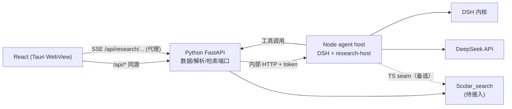

# DSH 接入完整方案（paper-reflow 研究功能）

> 版本：v1.0（源码核对版）  
> 日期：2026-11-08  
> 状态：架构已定，A0 已跑通；P0 之后进入 A1/A2  
> 源码参考：`F:\Agent\dsh-ref-rc7`（GitHub `dsh-v0.1.0-rc.7`，commit `99f6f02`）  
> 产品设计：[2026-11-08-research-agent-design.md](2026-11-08-research-agent-design.md)  
> 实施计划：[2026-11-08-research-agent-phase-a.md](../plans/2026-11-08-research-agent-phase-a.md)

---

## 0. 结论

**是，应该参考 DSH 源码；但要按“接入 seam”读，不通读、不 fork。**

最终方案：

1. **DSH 作为 agent runtime**，跑在独立的 Node sidecar 里。
2. **不套 DSH 的 Web UI**，也不把 SDK/ACP 当主协议；自研一个很薄的 `research-host` 插件，把 DSH 的会话事件投影成产品 SSE。
3. **完整组合**：`dsh-base` + `@paper-reflow/dsh-research` patch；禁用 `hmr` 后完整组合已能启动。
4. **直接 `boot()`**，不走 `dsh --profile`：Node 24 / Windows 把 profile 的 junction 认成普通目录，`dsh` 的 `ensureSymlink` 会拒绝启动。
5. **Python 仍是数据/解析平面**；React 自绘研究首页、项目页、思维链；外部检索等 `Scolar_search` 接入后走 `AcademicSearchBackend` 端口。
6. **A0 已跑通**：健康检查、创建/恢复会话、SSE、reasoning、工具卡、文本、`turn.end`、重启 resume；Tauri 侧编译通过，端到端还卡在现有 Python sidecar 健康检查。

---

## 1. 源码事实：`F:\Agent\dsh-ref-rc7` 是什么

它是 **DeepSeek Harness 的公开源码**，浅克隆自：

```
https://github.com/deepseek-ai/deepseek-harness
tag: dsh-v0.1.0-rc.7
commit: 99f6f02
```

我们运行时装的是 `0.1.0-rc.6`，GitHub 上没有 `rc.6` tag；`rc.7` 是最接近的公开源码。**rc.6 与 rc.7 的 API 可能有小差异，落地前以 `node_modules` 里的 `.d.ts` 和 `lib` 为准。**

源码里对我们最重要的包：

| 路径 | 作用 |
|---|---|
| `packages/boot/app-boot` | `boot()`、profile、patch 合成、include 树 |
| `packages/bundle/base` | `dsh-base` 的全部基础 row（`cordis.patch.yml`） |
| `packages/bundle/web-app` | 官方 Web 宿主：怎么组合、怎么接前端、哪些 row 要禁 |
| `packages/core/agent` | `ctx.agents` 注册表、create/resume、followup、cancel |
| `packages/core/agent-loop` | turn/step 循环、请求组装、工具调用 |
| `packages/core/session` | 事件溯源、`session/event`、surface、fork |
| `packages/core/session-persistence-jsonl` | zstd jsonl 日志、恢复、崩溃修复 |
| `packages/tool/tools` | `defineTool`、工具注册、`presentCall` / `presentResult` |
| `packages/host/webserver` | HTTP/SSE 路由载体 |
| `packages/sdk` | 进程外 SDK（stdio JSON-RPC） |
| `packages/acp` | ACP 自动化服务器 |
| `packages/examples/jsonrpc-demo` | SDK 运行时的最小组合示例 |

### 1.1 源码核对后的四个关键结论

1. **直接 `boot()` 是官方路径。**  
   `apps/cli` 的 profile 启动最终也是 `boot(NAME, rootConfig, patches)`；profile 只是组合便利层。我们跳过它，不破坏 DSH 的契约。

2. **完整组合卡住是因为 `hmr`。**  
   官方 `packages/bundle/web-app/cordis.patch.yml` 明确写了 `hmr.disabled: true`；研究 bundle 同样禁用后，`dsh-base + 研究 patch` 完整启动成功，并产生 `session/title` 事件。

3. **官方 SDK / ACP 不适合做交互式 UI 的主通道。**  
   - SDK：没有 per-prompt cancel；只传已提交消息，不传 reasoning/工具卡；  
   - ACP：面向自动化，不传 reasoning、计划、工具展示；  
   - 两者都适合 CI/子代理，不适合“停止按钮 + 思维链 + 工具卡”。

4. **官方 Web 客户端不建议复用。**  
   `dsh-client-*` 绑定 DSH 自己的 Cordis 客户端运行时和 Typert RPC；产品 IA 也不同。复用成本高于自绘。

---

## 2. 路线对比

| 路线 | 做法 | 取消 | reasoning | 工具卡 | 自有 UI | 工期 | 结论 |
|---|---|---|---|---|---|---|---|
| **A. 自研 host 插件** | Node sidecar 里 `boot()`，`research-host` 投影 SSE | ✅ | ✅ | ✅ | ✅ | 中 | **推荐** |
| B. SDK stdio | `dsh-sdk-client` 驱动运行时 | ❌ | 部分（事件里有，但客户端只取已提交） | 弱 | ✅ | 中 | 只适合自动化 |
| C. ACP | `dsh-acp` + ACP 客户端 | ✅ | ❌ | ❌ | 部分 | 中 | 只适合自动化 |
| D. dsh web UI | 直接嵌 `dsh web` | ✅ | ✅ | ✅ | ❌ | 短 | IA 不匹配 |
| E. 自研 agent loop | Python/TS 自己调模型 | ✅ | ✅ | ✅ | ✅ | 长 | 重复造轮子 |

**选 A。** 我们只写“宿主 + 投影 + 工具”，agent loop、会话、压缩、恢复、工具呈现全部复用 DSH。

---

## 3. 总体架构



| 进程 | 职责 | 不做什么 |
|---|---|---|
| React | 页面、SSE 状态机、引用渲染 | 不直连模型/检索，不存密钥 |
| Python | 项目/文献/产物/来源；本地库检索；PDF 解析；对外 API；SSE 代理 | 不跑 agent loop |
| Node host | DSH 组合、会话生命周期、工具、事件投影、SSE | 不读写文献库 PDF/blocks |
| DSH | 模型请求、工具编排、压缩、持久化、恢复 | 产品语义 |
| Scolar_search | 外部学术检索、详情、OA 全文、引用格式 | 不重复建设 |

**一个 Node host 服务所有项目**：DSH 进程重；会话自带 `cwd`；工具按 `project_id` 做路径校验。需要硬隔离时再 per-project。

---

## 4. DSH 组合与启动

### 4.1 组合

```
agent/
  src/bin.mjs              # 入口：boot()
  cordis.yml               # 空根配置 []
  minimal.yml              # A0 快速测试
  bundle/
    package.json           # @paper-reflow/dsh-research
    cordis.patch.yml       # 研究 patch
    lib/index.js           # research-host
    lib/tools.js           # echo + 后续工具
  node_modules/            # DSH rc.6（pnpm 锁定）
```

`src/bin.mjs` 的核心：

```js
const full = process.env.PAPER_REFLOW_AGENT_COMPOSE === 'full'
const ctx = await boot(
  'paper-reflow-agent',
  join(agentDir, full ? 'cordis.yml' : 'minimal.yml'),
  full ? [...loadBasePatch(), ...loadResearchPatch()] : [],
)
```

`full` 就是生产组合：`dsh-base` patch + 研究 patch。

### 4.2 研究 patch

```yaml
- insert:
    - id: research-webserver
      name: '@deepseek-ai/dsh-host-webserver'
      config: { host: 127.0.0.1, port: !!js Number(process.env.PAPER_REFLOW_AGENT_PORT || 0) }
    - id: research-host
      name: '@paper-reflow/dsh-research'
      config:
        token: !!js process.env.PAPER_REFLOW_AGENT_TOKEN || ''
        defaultModel: !!js process.env.PAPER_REFLOW_MODEL || 'deepseek-v4-flash'
    - id: research-tools
      name: '@paper-reflow/dsh-research/tools'

- id: llm-deepseek
  config:
    apiKeyEnv: PAPER_REFLOW_LLM_KEY
    baseURL: !!js process.env.PAPER_REFLOW_LLM_BASE || 'https://api.deepseek.com'
    thinking: enabled
    reasoningEffort: high

- id: web-search-deepseek
  config: { apiKeyEnv: PAPER_REFLOW_LLM_KEY }

# 打包应用不需要 HMR；官方 web bundle 也禁用
- id: hmr
  disabled: true

# 研究 agent 不拿 shell / 任意 fs
- id: tool-bash
  disabled: true
- id: tool-pwsh
  disabled: true
- id: tool-fs
  disabled: true
- id: tool-fs-search
  disabled: true
- id: tool-str-replace-editor
  disabled: true
- id: tool-jobs
  disabled: true
- id: tool-ralph
  disabled: true
- id: tool-workflow
  disabled: true
- id: tool-goal
  disabled: true
- id: tool-subagent
  disabled: true
- id: tool-subagent-fork
  disabled: true
- id: tool-subagent-control
  disabled: true
- id: tool-subagent-list-agents
  disabled: true
- id: tool-subagent-report
  disabled: true
- id: plan-mode
  disabled: true
- id: agent-instructions
  disabled: true
- id: session-telemetry-otel
  disabled: true
```

保留：`tool-todo`、`tool-skill`、`tool-web`、`session-title-first-prompt-llm`、`compaction-basic`、`tool-result-pruner`、`session-checkpoint-policy`、`token-meter`、`timeout-policy`、`spill-policy`、`attachment-local`。

### 4.3 Node 24 / Windows 的坑

`dsh --profile` 会在 `$DSH_HOME/profiles/node_modules` 下为每个包建 junction。Node 24 的 `lstatSync` 把 junction 报成普通目录，`ensureSymlink` 直接抛：

```
dsh: ...\profiles\node_modules\@deepseek-ai\dsh exists and is not a symlink
```

处理：

- **A0–现在**：直接 `boot()`，不经过 profile。
- **以后**：DSH 修复或换 Node 22 后再评估 profile；当前不阻塞。
- **不要**改 `node_modules` 里的 DSH 代码；适配放 `agent/src`。

### 4.4 Tauri 启动

`AgentSidecar` 照 Python sidecar 的模式：

1. 先为 agent 选空闲端口、生成随机 token；再为 Python 选端口、生成 token。
2. spawn Python sidecar，并把 `PAPEREAD_AGENT_PORT` / `PAPEREAD_AGENT_TOKEN` 一并注入其环境。
3. spawn `node <agent>/src/bin.mjs`，env：
   ```
   PAPEREAD_AGENT_PORT / PAPEREAD_AGENT_TOKEN
   PAPEREAD_AGENT_COMPOSE=full
   PAPEREAD_API_BASE=http://127.0.0.1:<python>
   PAPEREAD_TOKEN=<python token>
   PAPEREAD_LLM_KEY / PAPEREAD_LLM_BASE / PAPEREAD_MODEL
   DSH_HOME=%LOCALAPPDATA%\paperead-data\dsh
   ```
4. 轮询 `/v1/health`，30s 超时。
5. 失败：研究入口显示“引擎未启动”，文献库/阅读器不受影响。
6. 退出：Windows Job Object `KILL_ON_JOB_CLOSE`。

> agent 地址不落盘：Python 代理直接从环境变量读取 `PAPEREAD_AGENT_PORT` / `PAPEREAD_AGENT_TOKEN`，
> 前端只连 Python，永远看不到 agent 端口和 token。

---

## 5. 会话、事件与思维链

### 5.1 会话映射

| 产品 | DSH |
|---|---|
| 项目 | 目录 `projects/<id>/` + `session.meta.cwd` |
| 会话 | `Session`（id = 产品 UUID） |
| 一轮 | `turn` |
| 一次模型+工具 | `step` |
| 工具调用 | `tool/call` + `tool/result` |
| 研究计划 | `todo/write` |
| 会话标题 | `session/title` |

创建/恢复：

```js
const handle = await ctx.agents.create({
  sessionId,
  meta: { cwd: project.workspace },
  agentOptions: { provider: 'deepseek-official', model },
})

// 进程重启后
const handle = await ctx.agents.resume({ resumeSessionId: sessionId, agentOptions })
```

发送/停止：

```js
agent.followup(createUserMessage({
  content: [{ type: 'text', text }],
  source: { kind: 'user' },
}))
agent.cancel({ kind: 'user' }, { keepInbox: false })
```

### 5.2 事件投影

| DSH | 产品 SSE | UI |
|---|---|---|
| `turn/start` | `turn.start` | 计时 |
| `assistant/chunk` `reasoning-delta` | `reasoning.delta` | 思考（默认折叠） |
| `assistant/chunk` `text-delta` | `text.delta` | 正文流 |
| `assistant/chunk` `tool-call-delta` | `tool.draft` | 运行中卡片 + 查询预览 |
| `tool/call` | `tool.start` | 卡片出现 |
| `tool/result` | `tool.end` | 完成/失败 + 来源 + 耗时 |
| `todo/write` | `plan.update` | 计划清单 |
| `turn/end` | `turn.end` | “已处理 47 秒” |
| `session/title` | `title.update` | 会话标题 |

**三个关键点**：

1. `tool-call-delta` 的参数字符串是分片的；用容错 JSON 解析/正则提取 `query`，实现截图里的“执行中卡片实时显示检索式”。
2. 卡片由工具自己的 `presentCall` / `presentResult` 定义；结构化来源放 `output.presentationMeta`，随 `tool/result.meta` 持久化，回放一致。
3. 合并/节流：`text.delta` 30ms、`reasoning.delta` 50ms、`tool.draft` 100ms；SSE 心跳 15s；每会话单调 `seq`。

### 5.3 停止、恢复、重新生成

- 停止：`agent.cancel`；保留已生成文本和已完成卡片。
- 崩溃：DSH 日志修复；下次打开提示“上次检索被中断”。
- 重新生成：`ctx.sessions.fork(source, boundary)` 从上一轮分叉，不覆盖原会话。
- 空闲 30 分钟 dispose，日志保留，下次 resume。

### 5.4 思维链 UI

三层：

1. **计划**：`todo_write` checklist。
2. **轨迹**：工具卡按时间；连续同工具合并 `学术搜索 ×5`；每卡显示标题、副标题（检索式/DOI）、耗时、状态、展开结果。
3. **思考**：`reasoning-delta`，默认折叠；`showReasoning=false`，设置可开。

结束折叠为：

```
已处理 47 秒 · 5 次检索 · 12 个来源 · 8.4k tokens    [展开过程]
```

---

## 6. 工具层

### 6.1 为什么不用 MCP 做核心

- 核心工具需要 `presentCall/presentResult`、`presentationMeta`、流式进度、取消；
- MCP 工具没有 DSH 卡片元数据，且多一层进程；
- MCP 留给“以后接第三方数据源”。

### 6.2 工具清单

| 工具 | 作用 | 后端 |
|---|---|---|
| `library_search` | 本地库 FTS5 | Python |
| `academic_search` | 外部学术检索 | `SearchBackend`（Scolar） |
| `paper_get` | 单篇元数据/摘要 | Scolar `getPaper` |
| `paper_read` | 读本地全文/段落 | Python |
| `paper_ingest` | OA 下载入库/合法全文入口 | Python + Unpaywall |
| `citation_check` | 引用核验 | Python |
| `project_write` | 写产物 | Node |
| `project_file_read` | 读项目文件 | Python |

内建：`web_search`、`todo_write`、`skill`。

### 6.3 工具实现骨架

```js
ctx.tools.register(defineTool({
  name: 'academic_search',
  description: '检索学术文献，返回可核查的题名/年份/DOI/摘要。',
  parameters: {
    query: { type: 'string', required: true },
    sources: { type: 'array' },
    sort: { type: 'string' },
    field: { type: 'string' },
    phrase: { type: 'boolean' },
    year_from: { type: 'number' },
    year_to: { type: 'number' },
    limit: { type: 'number' },
  },
  output: {
    schema: { type: 'object', additionalProperties: true },
    render: (_args, value) => [{ type: 'text', text: renderWorks(value) }],
    presentationMeta: (_args, value) => ({ sources: value.sources }),
  },
  async execute(args) {
    return searchBackend.search(args)
  },
  presentCall(args) {
    return { card: 'generic', kind: 'academic-search', title: '学术搜索', rawInput: args }
  },
  presentResult(_args, result) {
    return { card: 'generic', title: `找到 ${result.sources.length} 篇` }
  },
}))
```

### 6.4 Scolar_search 接入

**不重写 provider。** 等 `F:\Project\Scolar_search` 接入后，二选一：

- **A. TS 包 seam（推荐）**：抽 `@paper-reflow/scholar-search`，Node 直接 import；
- **B. HTTP seam**：Scolar 暴露 `/api/search`、`/api/paper/:id`、`/api/fulltext`，Python 代理。

现在用 `FakeAcademicSearchBackend` + fixture 跑通 UI/E2E；换后端不动工具 schema 和会话日志。

**数据映射**：`Paper.id` → `Source.externalId`；`source` → `provider`；`citations` → `citedBy`；`pdfUrl/htmlUrl` 直传。`Source` 增加 `externalId/pdfUrl/htmlUrl/publishedAt/category/keywords`。

**多源合并**：Scolar 是单源请求；适配层 fan-out，按 `id/doi/标题+年份` 去重，摘要取最长、引用取最大、OA 优先。

### 6.5 引用真实性

- 来源注册表：`L` 本地库、`S` 学术库、`W` 网页、`F` 项目文件；会话内递增。
- 模型写 `[[S3]]`；UI 渲染 `[3]`；未知编号红色“未核实”。
- `citation_check` 用 `getPaper`/Crossref + 标题相似度/年份/作者判定；不自动改写 DOI。
- 禁止 SCI-Hub/LibGen；只走 OA/Unpaywall/用户上传。

---

## 7. 前端与产品形态

### 7.1 路由（不改默认首页）

- `/`、`/?p=` 保持文献库/阅读页。
- `/?view=research` 研究首页。
- `/?view=review` 写综述报告首页。
- `/?view=project&id=` 项目页（返回按 `kind`）。
- `/?research=spike` A0 冒烟页（临时）。
- 现有 `Sidebar` 增加“研究 / 写综述报告 / 参考文献引用助手”入口；研究与写综述激活时，下方只列本功能的项目（设计 §22）。

### 7.2 页面

- **研究首页**：hero、项目分段、composer（`@`/`$`）、六个快捷动作、热门问题、最近项目。
- **项目页**：文件/会话、对话、思维链、来源抽屉、产物。
- **写综述**：大纲 → 证据表 → 分节落盘 → docx/bib。
- **引用助手**：上传稿件 → 批量核验 → 修正 bib/报告。

### 7.3 对齐截图

| 截图元素 | 实现 |
|---|---|
| 左侧导航 | 全局 Sidebar；研究与写综述各自只列本功能项目，不列会话 |
| 快速开始/项目切换 | `ResearchHome` / `ReviewHome` |
| `@`/`$` 输入框 | `Composer` + Mention/Skill 菜单 |
| 六个快捷动作 | 创建会话 + 预置技能 |
| 大家都在搜 | 可配置热门问题 |
| 项目页文件/会话 | `ProjectRail` + `ProjectFileTree` |
| “已处理 47 秒” | `turn.end` 时长 |
| 叙述 + 工具卡 | `text.delta` + `ToolCard`/`ToolGroup` |
| 执行中检索式 | `tool.draft` 部分参数 |
| 停止按钮 | `agent.cancel` |

### 7.4 引用渲染

- `[[S3]]` → `[3]` chip；hover 题名/作者/年份/DOI；点击来源抽屉或阅读器。
- 未知编号 → 红色未核实 + 顶部提示。
- 网页用 markdown 链接，匹配 `meta` URL 渲染。
- 回答末尾按“文献库/学术库/网页”分组。

---

## 8. 数据与存储

```
%LOCALAPPDATA%\paper-reflow\
  data\                       # 现有文献库
  research\
    research.db               # SQLite WAL
    projects\<id>\
      project.json
      files\
      artifacts\
  dsh\
    sessions\--<cwd>--\<sessionId>\session.jsonl.zstd
  logs\agent.log
```

SQLite：`projects`、`project_items`、`sessions`、`session_sources`、`artifacts`、`search_cache`；FTS5 `papers_fts` + `blocks_fts`（trigram）。

真源边界：

- 会话/消息：DSH zstd jsonl；
- 来源：`tool/result.meta.sources`；
- 项目/文献/产物：SQLite + 文件系统；
- 来源/产物索引：`turn/end` 后回写。

---

## 9. API 与协议

### 9.1 对外

```
GET  /api/research/health
GET  /api/research/home
POST /api/research/projects
GET  /api/research/projects/{id}/sessions
POST /api/research/projects/{id}/sessions
GET  /api/research/sessions/{id}/transcript
GET  /api/research/sessions/{id}/events      # SSE
POST /api/research/sessions/{id}/messages
POST /api/research/sessions/{id}/cancel
POST /api/research/sessions/{id}/fork
GET  /api/research/artifacts/{id}
```

### 9.2 内部

Node `research-host`：

```
GET  /v1/health
POST /v1/sessions
POST /v1/sessions/:id/messages
POST /v1/sessions/:id/cancel
GET  /v1/sessions/:id/events
```

Python 内部：

```
POST /internal/search/library
POST /internal/search/academic
POST /internal/papers/ingest
POST /internal/papers/{id}/read
POST /internal/citations/check
```

### 9.3 SSE 事件

`turn.start`、`turn.end`、`reasoning.delta`、`text.delta`、`tool.draft`、`tool.start`、`tool.progress`、`tool.end`、`plan.update`、`artifact.update`、`notice`、`title.update`、`ping`。每事件带 `seq`，支持 `after` 续传。

---

## 10. 打包、安全、合规

### 10.1 打包

- Node 22/24 + `agent/node_modules` + `agent/src` + `bundle`；压缩后安装包 +80–120MB。
- `scripts/build-agent.ps1`：pnpm deploy、复制、`boot` 冒烟。
- Tauri `resources/agent`，按 per-user 安装。
- 版本锁定 rc.6；升级独立 PR + 契约测试。

### 10.2 安全

- Node/Python 只绑 `127.0.0.1`；Python cookie + Origin；Node 内部 token。
- 研究 key 存 DPAPI，启动时解密到 env，不写日志。
- 工具只访问项目 `files/`、`artifacts/`、库内论文；`realpath` 校验。
- 网络白名单 + OA 下载 SSRF 防护（私网/重定向/大小/content-type）。
- 摘要/网页视为不可信数据，`<untrusted_source>` 包裹；无 shell/run_code。
- 遥测默认关闭。

### 10.3 合规

- 不做 CNKI/万方/Google Scholar 抓取。
- **不接 SCI-Hub/LibGen/Z-Library**；只走 OA/Unpaywall/用户上传。
- 导出保留 DOI/URL 与“生成于 paper-reflow”。

---

## 11. 实施计划

### 11.1 A0 已完成

| 项 | 状态 |
|---|---|
| `agent/` + DSH rc.6 依赖锁定 | ✅ |
| `research-host` health/sessions/SSE/messages/cancel | ✅ |
| echo 工具 + 假 LLM 冒烟 | ✅ |
| 完整组合（`hmr` 禁用）启动 + `title.update` | ✅ |
| 重启 resume，turn 递增 | ✅ |
| `AgentSidecar` 编译 | ✅ |
| `?research=spike` 构建 | ✅ |
| Tauri 端到端（Python + Node + 窗口） | ✅ 用可写 `PAPER_REFLOW_DATA` 验证；日志 `sidecar ready` / `agent ready` |
| Python SSE 代理（`/api/research/*`） | ✅ 最小版已跑通，SpikePage 已改走代理 |
| 安装包体积/干净 Windows | ⏳ |

### 11.2 下一阶段顺序

| 阶段 | 工期 | 内容 | 验收 |
|---|---|---|---|
| **P0** | 已完成 | 修 Python sidecar 启动/健康检查；Tauri 同时拉起 Python + Node | ✅ 可写数据目录下 `sidecar ready` / `agent ready` |
| **P0.5** | 已完成 | 源码 6 个 seam 笔记；升级/契约测试清单 | ✅ `agent/docs/dsh-integration-notes.md` |
| **P1** | 已完成 | 完整组合回归：tools/todo/title/meta + resume | ✅ `npm run test:full`；skills/compaction 深触发待补 |
| **P2** | 已完成 | Python SSE 代理；env 注入 agent 端点 | ✅ 无 `agent.json`，前端只连 Python |
| **A1** | 3–4 天 | 项目/会话/产物/来源 SQLite + API | 重启后数据完整 |
| **A3** | 2–3 天 | 研究 UI 壳、`?view=research`、默认首页不变 | 路由/空状态/侧栏 |
| **A4** | 3–4 天 | SSE 客户端、transcript、停止/恢复 | 断线重连不丢 |
| **A5** | 3–4 天 | 思维链组件（计划/工具卡/思考） | 对齐截图 |
| **A6** | 3–4 天 | 本地库/Fake 学术检索/paper_read | 工具卡完整 |
| **A7** | 3–4 天 | 来源注册表、引用、产物 | 引用可点/未核实提示 |
| **A8** | 2 天 | persona + 5 个技能骨架 | `$` 菜单 |
| **A9** | 3 天 | 假 LLM E2E + 打包 | CI 全绿 |

总计约 5 周（2 人可压缩到 3.5–4 周）。`Scolar_search` 接入插在 A6 之后，接口不变。

### 11.3 搜索接入检查点

- `academic_search` schema 冻结；
- `Source` 字段覆盖 `Paper`；
- Fake fixture 全字段；
- UI 不按 provider 分支；
- 契约测试：真实响应、429、空结果、超时。

---

## 12. 源码阅读清单（1 天，限时）

| 优先级 | 路径 | 问题 | 产出 |
|---|---|---|---|
| P0 | `packages/boot/app-boot/src/index.ts` | `boot()`/profile/patch 语义 | 启动路径结论 |
| P0 | `packages/bundle/web-app/cordis.patch.yml`、`src/index.ts` | 官方 Web 宿主组合；哪些 row 禁 | 禁用 row 表 |
| P0 | `packages/core/agent/src/*`、`core/agent-loop/src/*` | create/resume/followup/cancel 时序 | 会话生命周期图 |
| P1 | `packages/core/session/src/*`、`session-persistence-jsonl/src/*` | 事件/恢复/title/compaction | 事件映射终稿 |
| P1 | `packages/tool/tools/src/*` | defineTool/presentation/meta | 工具适配层接口 |
| P1 | `packages/host/webserver/src/*` | SSE 生命周期/dispose | host 回归用例 |
| P2 | `packages/sdk/*`、`packages/acp/*`、`examples/jsonrpc-demo` | 能否复用 | 结论：只做自动化 |

**不做**：不通读 7000 个文件；不复制 UI；不改 `node_modules`。

---

## 13. 风险

| 风险 | 缓解 |
|---|---|
| DSH rc API 变动 | 锁 rc.6；`agent/src` 适配层；契约测试；升级 PR |
| Node 24 junction | 直接 `boot()`；后续评估 Node 22/profile |
| 完整组合还有隐藏 watcher | `hmr` 已禁；逐个 row 二分启动 |
| Tauri/Python sidecar 超时 | P0 先修；agent 失败不影响阅读器 |
| 安装包 +100MB | 已接受；M0 实测；按需下载备选 |
| 引用编造 | 来源注册表 + citation_check + 未核实提示 |
| 提示词注入 | 不可信内容围栏；无 shell；路径白名单 |
| Scolar_search 接入延期 | FakeBackend + 冻结 schema；不阻塞 A1/A3 |

---

## 14. 验收（端到端）

- 默认首页仍是文献库，阅读页零回归。
- `/?view=research` 可建项目/会话，发消息，看到计划/工具卡/文本，停止，刷新恢复。
- 完整组合产生标题、压缩、技能目录。
- 本地库检索/读全文可用；Fake 学术检索返回稳定 fixture。
- `[[S1]]` 可点；未知引用红色提示。
- 产物写入/读取/版本可用。
- Tauri 安装包可启动；agent 失败时研究入口降级。
- 不出现 SCI-Hub/盗版链接。

---

## 15. 一句话执行建议

**P0 已跑通；下一步花 1 天读 6 个 seam，然后 P1 完整组合回归；不要先做 A1 数据层，也不要把 SDK/ACP 当主协议。**
